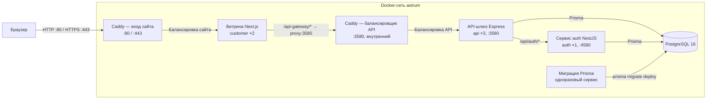
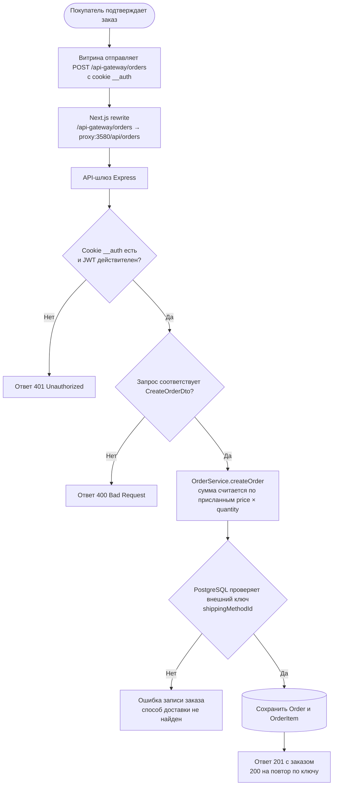

# Разработка

Внутренняя документация: как запускать проект, чем проверять изменения и какие правила соблюдать. Публичное описание проекта — в [README](../README.md).

## Требования

Node 24+, pnpm 12.8+, Docker.

## Приложения и порты

| Приложение           | Стек                 | Порт | Назначение                       |
| -------------------- | -------------------- | ---- | -------------------------------- |
| `apps/customer`      | Next.js 16           | 3000 | Витрина (B2C)                    |
| `apps/api-astrum`    | Express 5 + Prisma 7 | 3580 | API-шлюз (оркестратор)           |
| `apps/auth-astrum`   | NestJS 11 + Prisma 7 | 4580 | Аутентификация и пользователи    |
| `packages/Astrum-db` | Prisma client + zod  | —    | Общая БД-схема и обёртки моделей |

## Архитектура и сценарий заказа

Production-топология из `docker-compose.prod.yml`. Публичный и внутренний узлы Caddy на схеме — два listener одного контейнера; только proxy публикует порты хоста. `customer` обращается к API через внутренний listener, а API и auth подключаются к PostgreSQL напрямую. Одноразовый сервис `migrate` применяет схему до запуска приложений.



Браузер вызывает API по относительному пути `/api-gateway`, поэтому cookie сессии `__auth` остаётся same-origin. Внутренние порты API `3580` и auth `4580` на хост не публикуются.

Блок-схема показывает текущую реализацию `POST /api/orders`. Успешный путь возможен только при наличии указанного способа доставки в БД.



Цену, состав и остатки заказа теперь решает сервер: `POST /api/orders` принимает только `productId` и `quantity`, читает товары в транзакции, считает суммы в `Prisma.Decimal`, списывает остаток условным `updateMany` и отказывает кодами `OUT_OF_STOCK`, `CART_MISMATCH`, `MIXED_CURRENCY`, `UNKNOWN_SHIPPING_METHOD`. Отмена сделана отдельно: `PATCH /api/orders/:orderId/status` с `{ "status": "CANCELED" }` возвращает остаток и переводит строки в `CANCELLED`. Что осталось: таблица `ShippingMethod` по-прежнему пуста в чистой БД (id захардкожены в форме, неизвестный id даёт `409`), доставка не входит в `totalPrice`, остальные переходы статусов не сделаны. Эти части перечислены в блокерах ниже.

### Контракт идемпотентности

`POST /api/orders` принимает необязательный заголовок `Idempotency-Key`: от 8 до 128 символов из `[A-Za-z0-9_-]`, иначе `422` с `{ "code": "VALIDATION", "errors": [{ "property": "Idempotency-Key", ... }] }`. Ключ и sha256 отпечаток нормализованного тела (строки отсортированы по `productId`, дата приведена к UTC) пишутся в `Order.idempotencyKey` и `Order.idempotencyHash` тем же `create`, что и сам заказ.

| Запрос | Ответ |
| --- | --- |
| новый ключ | `201`, заказ создан |
| тот же ключ и то же тело | `200`, тот же `id`, заголовок `Idempotent-Replay: true`, ничего не пишется |
| тот же ключ и другое тело | `409 IDEMPOTENCY_KEY_REUSED`, ничего не пишется |
| ключ короче 8, длиннее 128 или с посторонним символом | `422 VALIDATION` |

Уникальный индекс `(userId, idempotencyKey)` держит гонку: проигравший перечитывает ключ на обычном клиенте (три попытки по 100 мс) и получает заказ победителя, а не отказ. Заказанные строки корзины удаляются или уменьшаются в той же транзакции, что списывает остаток; строки, которых нет в заказе, остаются нетронутыми. Витрина генерирует ключ из 16 случайных байт, держит его в `useRef` до окончательного ответа (сбрасывает после `2xx` и любого `4xx`, сохраняет после таймаута или `5xx`) и сама ничего не повторяет после `409`.

## Запуск

```bash
pnpm install
cp .env.example .env        # заполните JWT_SECRET и пароль БД
pnpm db:up                  # Postgres 16 в Docker
pnpm prisma:migrate:deploy
pnpm db:generate            # обязателен после чистого клона и после смены схемы
pnpm dev                    # docker start astrum-db + turbo dev
```

После старта: витрина <http://localhost:3000>, API <http://localhost:3580>, auth <http://localhost:4580>.

- **Демо-каталог**: `pnpm --filter @astrum/db seed:excel` читает xlsx из папки «Бесплатная база товаров 2018»; сами файлы в репозиторий не входят.
- **Смена схемы**: правка `packages/Astrum-db/prisma/schema.prisma` → `pnpm prisma:migrate:dev` → `pnpm db:generate`.
- **Пересоздать БД с нуля**: `pnpm db:restart`.
- **Порты**: 3580 и 4580 захардкожены в `src/server.ts` и `src/main.ts`; `API_PORT`/`AUTH_PORT` из `.env` не читаются.

## Скрипты

| Скрипт                       | Назначение                                   |
| ---------------------------- | -------------------------------------------- |
| `pnpm dev`                   | контейнер БД + все приложения в watch-режиме |
| `pnpm dev:customer`          | только витрина                               |
| `pnpm dev:api`               | только API-шлюз                              |
| `pnpm dev:auth`              | только auth-сервис                           |
| `pnpm build`                 | сборка всех пакетов через Turborepo          |
| `pnpm quality-gate`          | check-types + lint + test                    |
| `pnpm format`                | Prettier по репозиторию                      |
| `pnpm db:generate`           | генерация Prisma-клиента                     |
| `pnpm prisma:migrate:dev`    | новая миграция в dev                         |
| `pnpm prisma:migrate:deploy` | применение миграций                          |
| `pnpm prisma:studio`         | Prisma Studio                                |
| `pnpm db:up` / `pnpm db:rm`  | поднять / удалить контейнер БД               |

`dev:business` ссылается на `@astrum/business` — приложения пока нет, панель продавца в дорожной карте.
`prisma:seed` ссылается на несуществующий скрипт `seed`; рабочий сид — `seed:excel`.

## Качество кода

| Скрипт              | Назначение                               |
| ------------------- | ---------------------------------------- |
| `pnpm lint`         | ESLint по всем пакетам                   |
| `pnpm check-types`  | `tsc --noEmit` по всем пакетам           |
| `pnpm test`         | unit-тесты (Jest/Vitest) по всем пакетам |
| `pnpm quality-gate` | lint + check-types + test                |
| `pnpm format`       | Prettier авто-формат                     |
| `pnpm format:check` | Prettier проверка без записи             |

Хуки husky:

- **pre-commit** — prettier по staged файлам + `pnpm check-types`.
- **pre-push** — `pnpm quality-gate`.
- **commit-msg** — commitlint.

Проверить хук без коммита: `git hook run pre-commit`.

## Конвенция коммитов

Conventional Commits, тип и scope — на английском, описание — на русском. Типы: `feat`, `fix`, `docs`, `style`, `refactor`, `perf`, `test`, `chore`, `ci`, `build`, `revert`.

```
feat(api): добавить эндпоинт обновления заказа
fix(auth): исправить обработку просроченного токена
docs: описать архитектуру заказа
```

Валидация — commitlint (`.husky/commit-msg`, `commitlint.config.js`).

## Переменные окружения

| Файл                            | Ключи                                                                                                                                       |
| ------------------------------- | ------------------------------------------------------------------------------------------------------------------------------------------- |
| `.env.example`                  | `POSTGRES_*`, `DATABASE_URL`, порты приложений, `JWT_SECRET`, `AUTH_SERVICE_URL`, `API_GATEWAY_INTERNAL_URL`, `NEXT_PUBLIC_API_GATEWAY_URL` |
| `apps/api-astrum/.env.example`  | `DATABASE_URL`, `JWT_SECRET`, `AUTH_SERVICE_URL`, `API_PORT`                                                                                |
| `apps/auth-astrum/.env.example` | `DATABASE_URL`, `JWT_SECRET`, `AUTH_PORT`                                                                                                   |
| `apps/customer/.env.example`    | `NEXT_PUBLIC_API_GATEWAY_URL`, `JWT_SECRET`, `NODE_ENV`                                                                                     |

`JWT_SECRET` должен совпадать во всех сервисах. В браузер попадает только `NEXT_PUBLIC_*`.

## Документация и заметки

- [`docs/adr/`](./adr/README.md) — архитектурные решения, одно решение на файл, на английском.
- [`docs/changelog/`](./changelog/) — журнал изменений по датам, Conventional Commits.
- `docs/specs/` и `docs/scope/` появляются, когда пишется первая спека или скоуп.
- Зеркало заметок: `~/Documents/Obsidian Vault/Astrum/` (`Change Logs/`, `decisions/`, `notes/`), связи через `[[WikiLinks]]`.

## Чеклист готовности к MVP

Легенда: `[x]` работает и проверено вручную · `[ ]` не сделано · 🔥 блокер демо.

### ✅ Сделано

**Инфраструктура и качество**

- [x] Монорепо: pnpm 12 + Turborepo 2, три приложения и общий пакет БД
- [x] Postgres 16 в Docker, весь стек в Docker Compose: реплики api и customer за Caddy (ADR-0003)
- [x] Husky-хуки `commit-msg` / `pre-commit` / `pre-push`, commitlint, quality gates
- [x] ADR + журнал изменений, Swagger у auth-сервиса
- [x] Unit-тесты: подпись JWT, JWT-guard, errorHandler, контроллер отзывов

**Аутентификация и профиль**

- [x] Регистрация и вход, argon2, JWT (1 день) в HttpOnly-cookie `__auth`
- [x] Проверка токена на шлюзе + серверный guard маршрутов в Next (`proxy.ts`)
- [x] Профиль: редактирование, смена пароля, удаление аккаунта, выход

**Каталог**

- [x] 4745 товаров из xlsx, 10 категорий, карточка товара, рекомендации
- [x] Курсорная пагинация и поиск внутри категории
- [x] Вишлист, счётчики просмотров и продаж, скелетоны загрузки

**Корзина**

- [x] Добавление, изменение количества, удаление, выборочный чекаут
- [x] Контроль остатка товара, индикатор «в корзине» на карточке

**Заказы (каркас)**

- [x] Схема БД: `Order`, `OrderItem`, `ShippingMethod`, статусы заказа / позиции / оплаты
- [x] API: создание, список и карточка заказа; UI чекаута, список и детальная страница
- [x] Серверная цена и остатки: строки несут только `productId` и `quantity`, цена и имя берутся из `Product`, остаток списывается в транзакции, отказы приходят кодами `OUT_OF_STOCK` / `CART_MISMATCH` / `MIXED_CURRENCY` / `UNKNOWN_SHIPPING_METHOD`
- [x] Деньги заказа — `numeric(10,2)` с `currency`, в JSON уходят числами; заказ читает только владелец (`404` на чужой)
- [x] Тесты `OrderService`: подмена цены в теле, 20 параллельных заказов на склад 5, лимиты строк, чужая карточка
- [x] Отмена заказа: `PATCH /api/orders/:orderId/status` возвращает остаток, строки в `CANCELLED`, повторная отмена ничего не пишет
- [x] API отзывов: проверка покупки по `DELIVERED`, уникальность на позицию, модерация

**UI/UX**

- [x] 25 компонентов shadcn/Radix, адаптив, тёмная и светлая тема (next-themes), тосты, progress bar

### 🔥 Блокеры: заказ не проходит end-to-end

- [ ] **Методы доставки**: таблица `ShippingMethod` пуста в чистой БД, а ID захардкожены в форме (`CheckoutForm`) → неизвестный id даёт `409 UNKNOWN_SHIPPING_METHOD`. Нужны сид, `GET /shipping-methods`, подгрузка в форму
- [x] **Серверный пересчёт заказа**: `POST /api/orders` принимает только `productId` и `quantity`, цена и состав собираются из `Product` в транзакции, видимость и публикация проверяются. Доставка в `totalPrice` пока не входит — это отдельный пункт ниже
- [x] **Остатки**: `Product.quantity` списывается условным `updateMany` внутри той же транзакции, при нехватке весь заказ откатывается с `OUT_OF_STOCK` и свежим `available`; `isOutOfStock` выставляется на нуле. Возврат остатка при отмене остаётся за статусами
- [ ] **Корзина после заказа**: серверная корзина не очищается (фронт только ревалидирует SWR), позиции остаются в БД
- [ ] **Доступ к заказу**: владелец проверяется, чужой id даёт `404`. `getOrdersByUserId` по-прежнему не отдаёт позиции и способ доставки — решить вместе с экраном списка
- [ ] **Доставка в сумме**: `ShippingMethod.price` не прибавляется к `totalPrice`, форма показывает свою сумму с захардкоженной ценой доставки

### Ядро MVP

- [ ] **Смена статусов**: `PATCH /orders/:id/status` и `PATCH /order-items/:id/status` отсутствуют, хотя фронт их вызывает — кнопка «Cancel» получает 404
- [ ] **Панель продавца**: `dev:business` в скриптах ссылается на `@astrum/business`, приложения нет. Нужны список заказов, смена статусов, модерация отзывов, создание товара
- [ ] **Выдача покупателю**: самовывоза нет как модели — нужны пункты выдачи, статусы `READY_FOR_PICKUP` / `PICKED_UP`, код получения; либо явное подтверждение получения при доставке
- [ ] **Оплата**: сейчас только enum и строка `paymentDetails`, `paymentStatus` всегда `PENDING`. Нужен тестовый провайдер с вебхуком или честный сценарий «оплата при получении»
- [ ] **Уведомления**: ни одного письма — подтверждение заказа и «готов к выдаче» (nodemailer / Resend)

### Не примитивно: чем проект отличается от учебного

- [ ] Отзывы: UI живёт на моках с локальным состоянием — подключить к API, форма доступна после `DELIVERED`
- [ ] Сохранённые адреса, слоты доставки, валидация даты и адреса на сервере
- [ ] Скидки и валюта: `discount` не применяется, валюта захардкожена USD на всех экранах заказа
- [ ] Тесты сценария: Playwright «каталог → корзина → заказ → выдача» (unit на `OrderService` уже есть: подмена цены, 20 параллельных заказов, лимиты строк, чужой заказ)
- [ ] CI (GitHub Actions), демо-сид, скриншоты или GIF в README, рабочий `pnpm prisma:seed`

### 🏁 Definition of Done для MVP

1. Покупатель проходит каталог → корзина → чекаут → заказ без ошибок, сумма на экране совпадает с БД.
2. Остаток уменьшается, корзина очищается, повторный клик не создаёт второй заказ.
3. Продавец видит заказ в панели и ведёт его по статусам до выдачи.
4. Покупатель видит актуальный статус, получает товар и оставляет отзыв, который после модерации появляется на странице товара.
5. `pnpm quality-gate` зелёный, e2e-сценарий проходит в CI.

**Оценка:** блокеры — ~2 дня, ядро MVP — ~5–7 дней, полировка — ~2 дня.
