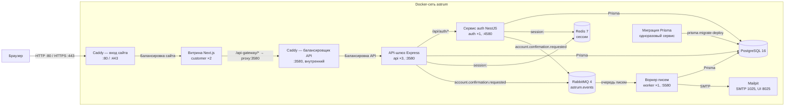
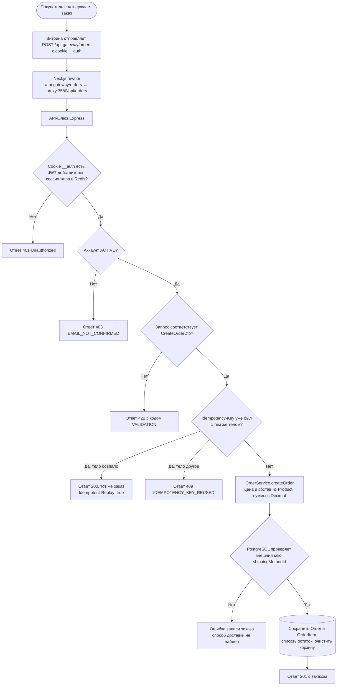

# Разработка

Внутренняя документация: как запускать проект, чем проверять изменения и какие правила соблюдать. Публичное описание проекта — в [README](../README.md).

## Требования

Node 24+, pnpm 12.8+, Docker.

## Приложения и порты

| Приложение             | Стек                 | Порт        | Назначение                                  |
| ---------------------- | -------------------- | ----------- | ------------------------------------------- |
| `apps/customer`        | Next.js 16           | 3000        | Витрина (B2C)                               |
| `apps/api-astrum`      | Express 5 + Prisma 7 | 3580        | API-шлюз (оркестратор)                      |
| `apps/auth-astrum`     | NestJS 11 + Prisma 7 | 4580        | Аутентификация и пользователи               |
| `apps/worker`          | Node 24 + amqplib    | 5580        | Письма подтверждения из очереди             |
| `packages/Astrum-db`   | Prisma client + seed | —           | Общая БД-схема, клиент и сид из xlsx        |
| `astrum-redis` (dev)   | Redis 7              | 6379        | Хранилище сессий                            |
| `astrum-rabbit` (dev)  | RabbitMQ 4           | 5672, 15672 | Обменник `astrum.events`, консоль на 15672  |
| `astrum-mailpit` (dev) | Mailpit              | 1025, 8025  | SMTP-приёмник писем и веб-интерфейс на 8025 |

## Архитектура и сценарий заказа

Production-топология из `docker-compose.prod.yml`. Публичный и внутренний узлы Caddy на схеме — два listener одного контейнера; порты хоста публикуют только `proxy` (80 и 443) и `mailpit` (8025, кэтчер писем). `customer` обращается к API через внутренний listener, а API, auth и worker подключаются к PostgreSQL напрямую. Сессии всех реплик сходятся в Redis, письма подтверждения идут через RabbitMQ в отдельный воркер. Одноразовый сервис `migrate` применяет схему до запуска приложений.



Браузер вызывает API по относительному пути `/api-gateway`, поэтому cookie сессии `__auth` остаётся same-origin. Внутренние порты API `3580` и auth `4580` на хост не публикуются.

Сессия живёт в двух местах: подписанный JWT `{ userId, sid }` в cookie `__auth` и запись `session:<sid>` в Redis с TTL 86400. Шлюз на каждом защищённом запросе сначала проверяет подпись, потом читает запись, и отказывает четырьмя кодами: `SESSION_MISSING` (нет cookie), `TOKEN_INVALID` (подпись или срок), `SESSION_REVOKED` (записи нет, она не разбирается, владелец в ней другой, или в токене нет `sid`) и `SESSION_STORE_UNAVAILABLE` (упал Redis, ответ всё равно `401`, а не `5xx`). Выход, смена пароля и удаление аккаунта удаляют запись, поэтому скопированная cookie перестаёт работать на всех репликах сразу. Redis входит в `GET /health`, так что при его падении реплика выходит из ротации, а не отвечает как здоровая.

Блок-схема показывает текущую реализацию `POST /api/orders`. Успешный путь возможен только при наличии указанного способа доставки в БД.



Цену, состав и остатки заказа теперь решает сервер: `POST /api/orders` принимает только `productId` и `quantity`, читает товары в транзакции, считает суммы в `Prisma.Decimal`, списывает остаток условным `updateMany` и отказывает кодами `OUT_OF_STOCK`, `CART_MISMATCH`, `MIXED_CURRENCY`, `UNKNOWN_SHIPPING_METHOD`. Отмена сделана отдельно: `PATCH /api/orders/:orderId/status` с `{ "status": "CANCELED" }` возвращает остаток и переводит строки в `CANCELLED`. Что осталось: таблица `ShippingMethod` по-прежнему пуста в чистой БД (id захардкожены в форме, неизвестный id даёт `409`), доставка не входит в `totalPrice`, остальные переходы статусов не сделаны. Эти части перечислены в блокерах ниже.

### Контракт идемпотентности

`POST /api/orders` принимает необязательный заголовок `Idempotency-Key`: от 8 до 128 символов из `[A-Za-z0-9_-]`, иначе `422` с `{ "code": "VALIDATION", "errors": [{ "property": "Idempotency-Key", ... }] }`. Ключ и sha256 отпечаток нормализованного тела (строки отсортированы по `productId`, дата приведена к UTC) пишутся в `Order.idempotencyKey` и `Order.idempotencyHash` тем же `create`, что и сам заказ.

| Запрос                                                | Ответ                                                                      |
| ----------------------------------------------------- | -------------------------------------------------------------------------- |
| новый ключ                                            | `201`, заказ создан                                                        |
| тот же ключ и то же тело                              | `200`, тот же `id`, заголовок `Idempotent-Replay: true`, ничего не пишется |
| тот же ключ и другое тело                             | `409 IDEMPOTENCY_KEY_REUSED`, ничего не пишется                            |
| ключ короче 8, длиннее 128 или с посторонним символом | `422 VALIDATION`                                                           |

Уникальный индекс `(userId, idempotencyKey)` держит гонку: проигравший перечитывает ключ на обычном клиенте (три попытки по 100 мс) и получает заказ победителя, а не отказ. Заказанные строки корзины удаляются или уменьшаются в той же транзакции, что списывает остаток; строки, которых нет в заказе, остаются нетронутыми. Витрина генерирует ключ из 16 случайных байт, держит его в `useRef` до окончательного ответа (сбрасывает после `2xx` и любого `4xx`, сохраняет после таймаута или `5xx`) и сама ничего не повторяет после `409`.

## Запуск

```bash
pnpm install
cp .env.example .env        # заполните JWT_SECRET и пароль БД
pnpm db:up                  # Postgres 16 и Redis 7 в Docker
pnpm prisma:migrate:deploy
pnpm db:generate            # обязателен после чистого клона и после смены схемы
pnpm dev                    # astrum-db, astrum-redis, astrum-rabbit, astrum-mailpit + turbo dev
```

После старта: витрина <http://localhost:3000>, API <http://localhost:3580>, auth <http://localhost:4580>, воркер писем <http://localhost:5580/health>, письма в Mailpit <http://localhost:8025>, консоль RabbitMQ <http://localhost:15672>.

- **Демо-каталог**: `pnpm --filter @astrum/db seed:excel` читает xlsx из папки «Бесплатная база товаров 2018»; сами файлы в репозиторий не входят.
- **Смена схемы**: правка `packages/Astrum-db/prisma/schema.prisma` → `pnpm prisma:migrate:dev` → `pnpm db:generate`.
- **Пересоздать БД с нуля**: `pnpm db:restart`.
- **Redis**: `REDIS_URL` обязателен для `api` и `auth`, без него процесс падает на старте, значения по умолчанию нет. Дев-файл compose публикует `6379` на хост, поэтому локально это `redis://localhost:6379`; в prod-файле порт наружу не выходит, а пароль задаёт `REDIS_PASSWORD` из `.env.prod`.
- **Брокер**: `RABBITMQ_URL` обязателен для воркера, он падает на старте без него. В `auth` и `api` соединение открывается при первой публикации, и отказ брокера логируется, а не роняет запрос. Дев-файл задаёт логин и пароль брокера через `RABBITMQ_USER` / `RABBITMQ_PASSWORD` (по умолчанию `astrum` / `change-me`), поэтому в строке подключения они обязательны: без них handshake отвечает `403 ACCESS-REFUSED`. После правки `.env` перезапустите процесс: watch-раннер читает файл один раз при старте.
- **Почта**: `SMTP_URL` в dev смотрит на Mailpit (`smtp://localhost:1025`); без него воркер пишет письмо в `MAIL_OUTBOX_DIR`. В прод-стеке Mailpit тоже поднят (интерфейс на `8025`), но `.env.prod.example` указывает `SMTP_URL` на реальный релей, поэтому для локальной проверки письма поставьте `smtp://mailpit:1025`. `STOREFRONT_URL` подставляется в ссылку подтверждения.
- **Порты**: `API_PORT` / `AUTH_PORT` / `WORKER_PORT` читаются из `.env`, по умолчанию 3580, 4580 и 5580.

## Скрипты

| Скрипт                         | Назначение                                                                   |
| ------------------------------ | ---------------------------------------------------------------------------- |
| `pnpm dev`                     | Postgres, Redis, RabbitMQ и Mailpit в Docker + все приложения в watch-режиме |
| `pnpm dev:customer`            | только витрина                                                               |
| `pnpm dev:api`                 | только API-шлюз                                                              |
| `pnpm dev:auth`                | только auth-сервис                                                           |
| `pnpm build`                   | сборка всех пакетов через Turborepo                                          |
| `pnpm quality-gate`            | check-types + lint + test                                                    |
| `pnpm format`                  | `biome format --write` по репозиторию                                        |
| `pnpm db:generate`             | генерация Prisma-клиента                                                     |
| `pnpm prisma:migrate:dev`      | новая миграция в dev                                                         |
| `pnpm prisma:migrate:deploy`   | применение миграций                                                          |
| `pnpm prisma:studio`           | Prisma Studio                                                                |
| `pnpm db:up` / `pnpm db:rm`    | поднять / удалить контейнеры Postgres и Redis                                |
| `pnpm docker:prod:build`       | собрать образы прод-стека                                                    |
| `pnpm docker:prod:up` / `down` | запустить / остановить прод-стек                                             |
| `pnpm docker:prod:scale`       | пересобрать и перезапустить реплики api                                      |

Воркер отдельным корневым скриптом не вынесен: `pnpm --filter @astrum/worker dev`.

`prisma:seed` ссылается на несуществующий скрипт `seed` в пакете БД; рабочий сид — `seed:excel`.

## Качество кода

| Скрипт              | Назначение                                                                |
| ------------------- | ------------------------------------------------------------------------- |
| `pnpm lint`         | ESLint в `customer` и `auth`; в `api`, `db` и `worker` заглушка           |
| `pnpm check-types`  | `tsc --noEmit` по всем пакетам                                            |
| `pnpm test`         | jest в `api` и `auth`, vitest в `customer`, `node:test` в `db` и `worker` |
| `pnpm quality-gate` | check-types + lint + test                                                 |
| `pnpm format`       | Biome, формат по репозиторию                                              |
| `pnpm format:check` | Biome, проверка без записи                                                |

Хуки husky:

- **pre-commit** — пустой (`exit 0`): коммит остаётся мгновенным, форматирование запускается вручную.
- **pre-push** — `pnpm quality-gate`: типы, линт и тесты по всем пакетам.
- **commit-msg** — commitlint через локальный бинарник, при его отсутствии проверка формата регуляркой.

Проверить хук без коммита: `git hook run pre-push`.

## Конвенция коммитов

Conventional Commits, тип и scope — на английском, описание — на русском. Типы: `feat`, `fix`, `docs`, `style`, `refactor`, `perf`, `test`, `chore`, `ci`, `build`, `revert`.

```
feat(api): добавить эндпоинт обновления заказа
fix(auth): исправить обработку просроченного токена
docs: описать архитектуру заказа
```

Валидация — commitlint (`.husky/commit-msg`, `commitlint.config.js`).

## Переменные окружения

| Файл                            | Ключи                                                                                                                                                                                                                                                                                                                      |
| ------------------------------- | -------------------------------------------------------------------------------------------------------------------------------------------------------------------------------------------------------------------------------------------------------------------------------------------------------------------------- |
| `.env.example`                  | `POSTGRES_*`, `DATABASE_URL`, `API_PORT`, `AUTH_PORT`, `WORKER_PORT`, `JWT_SECRET`, `DB_POOL_SIZE`, `REDIS_URL`, `RABBITMQ_URL`, `SMTP_URL`, `MAIL_FROM`, `STOREFRONT_URL`, `MAIL_OUTBOX_DIR`, `AUTH_SERVICE_URL`, `API_GATEWAY_INTERNAL_URL`, `NEXT_PUBLIC_API_GATEWAY_URL`                                               |
| `.env.prod.example`             | `POSTGRES_*`, `DATABASE_URL` (`db:5432`), `JWT_SECRET`, `DB_POOL_SIZE`, `AUTH_SERVICE_URL`, `REDIS_URL` + `REDIS_PASSWORD`, `API_GATEWAY_INTERNAL_URL`, `NEXT_PUBLIC_API_GATEWAY_URL`, `RABBITMQ_URL` + `RABBITMQ_USER` / `RABBITMQ_PASSWORD`, `SMTP_URL`, `MAIL_FROM`, `STOREFRONT_URL`, `WORKER_PORT`, `MAIL_OUTBOX_DIR` |
| `apps/api-astrum/.env.example`  | `DATABASE_URL`, `JWT_SECRET`, `AUTH_SERVICE_URL`, `API_PORT`, `REDIS_URL`, `RABBITMQ_URL`                                                                                                                                                                                                                                  |
| `apps/auth-astrum/.env.example` | `DATABASE_URL`, `JWT_SECRET`, `AUTH_PORT`, `REDIS_URL`, `RABBITMQ_URL`, `STOREFRONT_URL`                                                                                                                                                                                                                                   |
| `apps/worker/.env.example`      | `DATABASE_URL`, `RABBITMQ_URL`, `MAIL_FROM`, `STOREFRONT_URL`, `SMTP_URL`, `WORKER_PORT`, `MAIL_OUTBOX_DIR`                                                                                                                                                                                                                |
| `apps/customer/.env.example`    | `NEXT_PUBLIC_API_GATEWAY_URL`, `JWT_SECRET`, `NODE_ENV`                                                                                                                                                                                                                                                                    |

`JWT_SECRET` должен совпадать во всех сервисах. В браузер попадает только `NEXT_PUBLIC_*`. `REDIS_URL` обязателен для `api` и `auth`: без него процесс не стартует. `RABBITMQ_URL` обязателен для `worker` (падает на старте), а в `api` и `auth` читается при публикации, так что недоступный брокер даёт запись в лог, а не отказ на запросе. В `.env.prod.example` рядом с `REDIS_URL` лежит `REDIS_PASSWORD` для `--requirepass`.

## Документация и заметки

- [`docs/adr/`](./adr/README.md) — архитектурные решения, одно решение на файл, на английском.
- [`docs/changelog/`](./changelog/) — журнал изменений по датам, Conventional Commits.
- [`docs/specs/`](./specs/) — спеки фич: контракт, обоснование и лог проверки.
- [`docs/scope/`](./scope/index.md) — живой скоуп по воркспейсам и статусы фич.
- Зеркало заметок: `~/Documents/Obsidian Vault/Astrum/` (`Change Logs/`, `decisions/`, `notes/`), связи через `[[WikiLinks]]`.

## Чеклист готовности к MVP

Легенда: `[x]` работает и проверено вручную · `[ ]` не сделано · 🔥 блокер демо.

### ✅ Сделано

**Инфраструктура и качество**

- [x] Монорепо: pnpm 12 + Turborepo 2, четыре приложения (витрина, шлюз, auth, воркер) и общий пакет БД
- [x] Postgres 16 в Docker, весь стек в Docker Compose: реплики api и customer за Caddy (ADR-0003), Redis для сессий, RabbitMQ и воркер для писем
- [x] Husky-хуки `commit-msg` / `pre-commit` / `pre-push`, commitlint, quality gates
- [x] ADR + журнал изменений, Swagger у auth-сервиса
- [x] Unit-тесты: подпись JWT, JWT-guard, errorHandler, контроллер отзывов, модуль заказа, воркер писем, правила DTO

**Аутентификация и профиль**

- [x] Регистрация и вход, argon2, JWT (1 день) в HttpOnly-cookie `__auth` плюс запись `session:<sid>` в Redis
- [x] Проверка токена и сессии в Redis на шлюзе + серверный guard маршрутов в Next (`proxy.ts`)
- [x] Подтверждение почты: статус `PENDING`, одноразовая ссылка на 24 часа, письмо через RabbitMQ и `apps/worker`, лимиты повторной отправки, смена адреса возвращает в `PENDING`
- [x] Профиль: редактирование, смена пароля, удаление аккаунта, выход

**Каталог**

- [x] 4745 товаров из xlsx, 10 категорий, карточка товара, рекомендации
- [x] Курсорная пагинация и поиск внутри категории
- [x] Вишлист, счётчики просмотров и продаж, скелетоны загрузки

**Корзина**

- [x] Добавление, изменение количества, удаление, выборочный чекаут
- [x] Контроль остатка товара, индикатор «в корзине» на карточке

**Заказы (каркас)**

- [x] Схема БД: `Order`, `OrderItem`, `ShippingMethod`, статусы заказа / позиции / оплаты
- [x] API: создание, список и карточка заказа; UI чекаута, список и детальная страница
- [x] Серверная цена и остатки: строки несут только `productId` и `quantity`, цена и имя берутся из `Product`, остаток списывается в транзакции, отказы приходят кодами `OUT_OF_STOCK` / `CART_MISMATCH` / `MIXED_CURRENCY` / `UNKNOWN_SHIPPING_METHOD`
- [x] Деньги заказа — `numeric(10,2)` с `currency`, в JSON уходят числами; заказ читает только владелец (`404` на чужой)
- [x] Тесты `OrderService`: подмена цены в теле, 20 параллельных заказов на склад 5, лимиты строк, чужая карточка
- [x] Отмена заказа: `PATCH /api/orders/:orderId/status` возвращает остаток, строки в `CANCELLED`, повторная отмена ничего не пишет
- [x] API отзывов: проверка покупки по `DELIVERED`, уникальность на позицию, модерация

**UI/UX**

- [x] 25 компонентов shadcn/Radix, адаптив, тёмная и светлая тема (next-themes), тосты, progress bar

### 🔥 Блокеры: заказ не проходит end-to-end

- [ ] **Методы доставки**: таблица `ShippingMethod` пуста в чистой БД, а ID захардкожены в форме (`CheckoutForm`) → неизвестный id даёт `409 UNKNOWN_SHIPPING_METHOD`. Нужны сид, `GET /shipping-methods`, подгрузка в форму
- [x] **Серверный пересчёт заказа**: `POST /api/orders` принимает только `productId` и `quantity`, цена и состав собираются из `Product` в транзакции, видимость и публикация проверяются. Доставка в `totalPrice` пока не входит — это отдельный пункт ниже
- [x] **Остатки**: `Product.quantity` списывается условным `updateMany` внутри той же транзакции, при нехватке весь заказ откатывается с `OUT_OF_STOCK` и свежим `available`; `isOutOfStock` выставляется на нуле. Возврат остатка при отмене остаётся за статусами
- [x] **Корзина после заказа**: заказанные строки удаляются или уменьшаются в той же транзакции, что создаёт заказ, невыбранные остаются; повторная отправка формы не создаёт второй заказ благодаря `Idempotency-Key`
- [ ] **Доступ к заказу**: владелец проверяется, чужой id даёт `404`. `getOrdersByUserId` по-прежнему не отдаёт позиции и способ доставки — решить вместе с экраном списка
- [ ] **Доставка в сумме**: `ShippingMethod.price` не прибавляется к `totalPrice`, форма показывает свою сумму с захардкоженной ценой доставки

### Ядро MVP

- [x] **Смена статуса заказа**: `PATCH /api/orders/:orderId/status` работает, отмена возвращает остаток и переводит строки в `CANCELLED`; `PATCH /order-items/:id/status` по-прежнему отсутствует
- [ ] **Панель продавца**: приложения `@astrum/business` в репозитории нет. Нужны список заказов, смена статусов, модерация отзывов, создание товара
- [ ] **Выдача покупателю**: самовывоза нет как модели — нужны пункты выдачи, статусы `READY_FOR_PICKUP` / `PICKED_UP`, код получения; либо явное подтверждение получения при доставке
- [ ] **Оплата**: сейчас только enum и строка `paymentDetails`, `paymentStatus` всегда `PENDING`. Нужен тестовый провайдер с вебхуком или честный сценарий «оплата при получении»
- [ ] **Уведомления**: письмо подтверждения уже отправляется через брокер и воркер, а писем о заказе и «готов к выдаче» нет

### Не примитивно: чем проект отличается от учебного

- [ ] Отзывы: UI живёт на моках с локальным состоянием — подключить к API, форма доступна после `DELIVERED`
- [ ] Сохранённые адреса, слоты доставки, валидация даты и адреса на сервере
- [ ] Скидки и валюта: `discount` не применяется, валюта захардкожена USD на всех экранах заказа
- [ ] Тесты сценария: Playwright «каталог → корзина → заказ → выдача» (unit на `OrderService` уже есть: подмена цены, 20 параллельных заказов, лимиты строк, чужой заказ)
- [ ] CI (GitHub Actions), демо-сид, скриншоты или GIF в README, рабочий `pnpm prisma:seed`

### 🏁 Definition of Done для MVP

1. Покупатель проходит каталог → корзина → чекаут → заказ без ошибок, сумма на экране совпадает с БД.
2. Остаток уменьшается, корзина очищается, повторный клик не создаёт второй заказ.
3. Продавец видит заказ в панели и ведёт его по статусам до выдачи.
4. Покупатель видит актуальный статус, получает товар и оставляет отзыв, который после модерации появляется на странице товара.
5. `pnpm quality-gate` зелёный, e2e-сценарий проходит в CI.

**Оценка:** блокеры — ~2 дня, ядро MVP — ~5–7 дней, полировка — ~2 дня.
