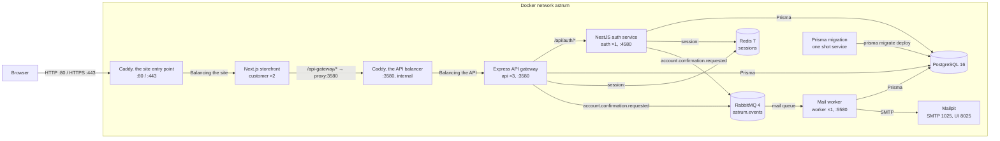
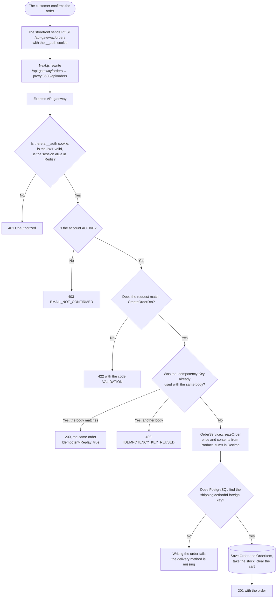

# Development

Internal documentation: how to run the project, how to check a change and which rules to follow. The public description of the project lives in [README](../README.md).

## Requirements

Node 24+, pnpm 12.8+, Docker.

## Applications and ports

| Application            | Stack                | Port        | Purpose                                               |
| ---------------------- | -------------------- | ----------- | ----------------------------------------------------- |
| `apps/customer`        | Next.js 16           | 3000        | Storefront (B2C)                                      |
| `apps/api-astrum`      | Express 5 + Prisma 7 | 3580        | API gateway (orchestrator)                            |
| `apps/auth-astrum`     | NestJS 11 + Prisma 7 | 4580        | Authentication and users                              |
| `apps/worker`          | Node 24 + amqplib    | 5580        | Confirmation letters from the queue                   |
| `packages/Astrum-db`   | Prisma client + seed | none        | Shared database schema, client and xlsx seed          |
| `astrum-redis` (dev)   | Redis 7              | 6379        | Session store                                         |
| `astrum-rabbit` (dev)  | RabbitMQ 4           | 5672, 15672 | The `astrum.events` exchange, console on 15672        |
| `astrum-mailpit` (dev) | Mailpit              | 1025, 8025  | SMTP receiver for letters and a web interface on 8025 |

## Architecture and the order flow

The production topology comes from `docker-compose.prod.yml`. The public and the internal Caddy listeners in the diagram are two listeners of one container; only `proxy` (80 and 443) and `mailpit` (8025, the letter catcher) publish host ports. `customer` reaches the API through the internal listener, and the API, auth and the worker connect to PostgreSQL directly. The sessions of every replica meet in Redis, and confirmation letters go through RabbitMQ into a separate worker. A one shot `migrate` service applies the schema before the applications start.



The browser calls the API at the relative path `/api-gateway`, so the `__auth` session cookie stays same origin. The internal ports of the API `3580` and of auth `4580` are never published to the host.

A session lives in two places: a signed JWT `{ userId, sid }` in the `__auth` cookie and a `session:<sid>` record in Redis with a TTL of 86400. On every guarded request the gateway checks the signature first and then reads the record, and refuses with four codes: `SESSION_MISSING` (no cookie), `TOKEN_INVALID` (signature or expiry), `SESSION_REVOKED` (the record is gone, does not parse, belongs to another user, or the token has no `sid`) and `SESSION_STORE_UNAVAILABLE` (Redis is down, the answer is still `401` and not `5xx`). Signing out, a password change and account deletion remove the record, so a copied cookie stops working on every replica at once. Redis is part of `GET /health`, so a failed Redis takes the replica out of rotation instead of answering as healthy.

The flow chart shows the current `POST /api/orders` implementation. The success path is possible only when the given delivery method exists in the database.



The server now decides the price, the contents and the stock of an order: `POST /api/orders` takes only `productId` and `quantity`, reads the products in a transaction, counts the sums in `Prisma.Decimal`, takes the stock with a conditional `updateMany` and refuses with the codes `OUT_OF_STOCK`, `CART_MISMATCH`, `MIXED_CURRENCY`, `UNKNOWN_SHIPPING_METHOD`. Cancelling is separate: `PATCH /api/orders/:orderId/status` with `{ "status": "CANCELED" }` returns the stock and moves the lines to `CANCELLED`. What is left: the `ShippingMethod` table is still empty in a clean database (the form hardcodes the ids, and an unknown id answers `409`), delivery is not part of `totalPrice`, and the other status transitions are not built. These parts are listed among the blockers below.

### The idempotency contract

`POST /api/orders` accepts an optional `Idempotency-Key` header: 8 to 128 characters from `[A-Za-z0-9_-]`, otherwise `422` with `{ "code": "VALIDATION", "errors": [{ "property": "Idempotency-Key", ... }] }`. The key and a sha256 fingerprint of the normalized body (lines sorted by `productId`, the date brought to UTC) are written into `Order.idempotencyKey` and `Order.idempotencyHash` by the same `create` that writes the order.

| Request                                                         | Answer                                                                         |
| --------------------------------------------------------------- | ------------------------------------------------------------------------------ |
| a new key                                                       | `201`, the order is created                                                    |
| the same key and the same body                                  | `200`, the same `id`, the header `Idempotent-Replay: true`, nothing is written |
| the same key and another body                                   | `409 IDEMPOTENCY_KEY_REUSED`, nothing is written                               |
| a key shorter than 8, longer than 128 or with a stray character | `422 VALIDATION`                                                               |

The unique index on `(userId, idempotencyKey)` handles the race: the losing request re-reads the key on a plain client (three attempts 100 ms apart) and gets the winner order instead of a refusal. The ordered cart lines are removed or decreased in the same transaction that takes the stock; lines that are not in the order stay untouched. The storefront generates the key from 16 random bytes, keeps it in a `useRef` until the final answer (resets it after `2xx` and any `4xx`, keeps it after a timeout or `5xx`) and never repeats on its own after a `409`.

## Running

```bash
pnpm install
cp .env.example .env        # fill in JWT_SECRET and the database password
pnpm db:up                  # Postgres 16 and Redis 7 in Docker
pnpm prisma:migrate:deploy
pnpm db:generate            # required after a clean clone and after a schema change
pnpm dev                    # astrum-db, astrum-redis, astrum-rabbit, astrum-mailpit + turbo dev
```

Once everything is up: the storefront at <http://localhost:3000>, the API at <http://localhost:3580>, auth at <http://localhost:4580>, the mail worker at <http://localhost:5580/health>, the letters in Mailpit at <http://localhost:8025> and the RabbitMQ console at <http://localhost:15672>.

- **Demo catalogue**: `pnpm --filter @astrum/db seed:excel` reads the xlsx files from the free product database folder; the files themselves stay out of the repository.
- **Schema change**: edit `packages/Astrum-db/prisma/schema.prisma`, run `pnpm prisma:migrate:dev`, then `pnpm db:generate`.
- **Recreate the database from scratch**: `pnpm db:restart`.
- **Redis**: `REDIS_URL` is required for `api` and `auth`, and without it the process dies on start, there is no default. The dev compose file publishes `6379` to the host, so locally it is `redis://localhost:6379`; in the prod file the port stays inside and the password comes from `REDIS_PASSWORD` in `.env.prod`.
- **Broker**: `RABBITMQ_URL` is required for the worker, which dies on start without it. In `auth` and `api` the connection opens on the first publish, and a broker refusal is logged instead of failing the request. The dev file sets the broker login and password through `RABBITMQ_USER` / `RABBITMQ_PASSWORD` (defaults `astrum` / `change-me`), so they are part of the connection string: without them the handshake answers `403 ACCESS-REFUSED`. Restart the process after editing `.env`, because the watch runner reads the file once at start.
- **Mail**: in dev `SMTP_URL` points at Mailpit (`smtp://localhost:1025`); without it the worker writes the letter into `MAIL_OUTBOX_DIR`. The prod stack runs Mailpit too (interface on `8025`), but `.env.prod.example` points `SMTP_URL` at a real relay, so set `smtp://mailpit:1025` to check a letter locally. `STOREFRONT_URL` goes into the confirmation link.
- **Ports**: `API_PORT` / `AUTH_PORT` / `WORKER_PORT` are read from `.env`, defaulting to 3580, 4580 and 5580.

## Interface language

The storefront answers in English by default and keeps Russian behind a switcher. Both catalogs live in `apps/customer/messages/` (`en.json` and `ru.json`), the resolution code in `apps/customer/src/i18n/`, and the chosen language in the `NEXT_LOCALE` cookie (one year, path `/`, readable by the request helpers). There is no language segment in the address.

- A new string is one entry in each catalog. The parity test in `apps/customer/src/i18n/config.test.ts` fails when the key trees or the interpolation placeholders diverge.
- A screen reads strings through `useTranslations` (client) or `getTranslations` (server), never a literal, so a Cyrillic literal in `apps/customer/src` means a missed screen.
- Validation messages come from `validation`, so a schema is built per language with `createRegisterFormSchema(t)` and friends instead of being a module constant.
- The confirmation letter follows the page that asked for it: the storefront sends the explicit `Accept-Language` header, both publishers carry `locale` in the event, and the worker picks `apps/worker/src/letters/en.ts` or `ru.ts`, with English as the fallback.

## Scripts

| Script                         | Purpose                                                                              |
| ------------------------------ | ------------------------------------------------------------------------------------ |
| `pnpm dev`                     | Postgres, Redis, RabbitMQ and Mailpit in Docker plus every application in watch mode |
| `pnpm dev:customer`            | the storefront only                                                                  |
| `pnpm dev:api`                 | the API gateway only                                                                 |
| `pnpm dev:auth`                | the auth service only                                                                |
| `pnpm build`                   | build every package through Turborepo                                                |
| `pnpm quality-gate`            | check-types, lint and test                                                           |
| `pnpm format`                  | `biome format --write` across the repository                                         |
| `pnpm db:generate`             | generate the Prisma client                                                           |
| `pnpm prisma:migrate:dev`      | a new migration in dev                                                               |
| `pnpm prisma:migrate:deploy`   | apply the migrations                                                                 |
| `pnpm prisma:studio`           | Prisma Studio                                                                        |
| `pnpm db:up` / `pnpm db:rm`    | start or remove the Postgres and Redis containers                                    |
| `pnpm docker:prod:build`       | build the images of the prod stack                                                   |
| `pnpm docker:prod:up` / `down` | start or stop the prod stack                                                         |
| `pnpm docker:prod:scale`       | rebuild and restart the api replicas                                                 |

The worker has no root script of its own: `pnpm --filter @astrum/worker dev`.

`prisma:seed` points at a `seed` script that does not exist in the database package; the working seed is `seed:excel`.

## Code quality

| Script              | Purpose                                                                          |
| ------------------- | -------------------------------------------------------------------------------- |
| `pnpm lint`         | ESLint in `customer` and `auth`; a stub in `api`, `db` and `worker`              |
| `pnpm check-types`  | `tsc --noEmit` across every package                                              |
| `pnpm test`         | jest in `api` and `auth`, vitest in `customer`, `node:test` in `db` and `worker` |
| `pnpm quality-gate` | check-types, lint and test                                                       |
| `pnpm format`       | Biome, formatting across the repository                                          |
| `pnpm format:check` | Biome, a check without writing                                                   |

Husky hooks:

- **pre-commit**: empty (`exit 0`), so a commit stays instant and formatting runs by hand.
- **pre-push**: `pnpm quality-gate`, meaning types, lint and tests across every package.
- **commit-msg**: commitlint through the local binary, and a regular expression check when the binary is missing.

Run a hook without committing: `git hook run pre-push`.

## Commit convention

Conventional Commits, with the type and the scope in English and the subject in Russian. The types are `feat`, `fix`, `docs`, `style`, `refactor`, `perf`, `test`, `chore`, `ci`, `build`, `revert`.

```
feat(api): добавить эндпоинт обновления заказа
fix(auth): исправить обработку просроченного токена
docs: описать архитектуру заказа
```

Validation comes from commitlint (`.husky/commit-msg`, `commitlint.config.js`).

## Environment variables

| File                            | Keys                                                                                                                                                                                                                                                                                                                             |
| ------------------------------- | -------------------------------------------------------------------------------------------------------------------------------------------------------------------------------------------------------------------------------------------------------------------------------------------------------------------------------- |
| `.env.example`                  | `POSTGRES_*`, `DATABASE_URL`, `API_PORT`, `AUTH_PORT`, `WORKER_PORT`, `JWT_SECRET`, `DB_POOL_SIZE`, `REDIS_URL`, `RABBITMQ_URL`, `SMTP_URL`, `MAIL_FROM`, `STOREFRONT_URL`, `MAIL_OUTBOX_DIR`, `AUTH_SERVICE_URL`, `API_GATEWAY_INTERNAL_URL`, `NEXT_PUBLIC_API_GATEWAY_URL`                                                     |
| `.env.prod.example`             | `POSTGRES_*`, `DATABASE_URL` (`db:5432`), `JWT_SECRET`, `DB_POOL_SIZE`, `AUTH_SERVICE_URL`, `REDIS_URL` with `REDIS_PASSWORD`, `API_GATEWAY_INTERNAL_URL`, `NEXT_PUBLIC_API_GATEWAY_URL`, `RABBITMQ_URL` with `RABBITMQ_USER` / `RABBITMQ_PASSWORD`, `SMTP_URL`, `MAIL_FROM`, `STOREFRONT_URL`, `WORKER_PORT`, `MAIL_OUTBOX_DIR` |
| `apps/api-astrum/.env.example`  | `DATABASE_URL`, `JWT_SECRET`, `AUTH_SERVICE_URL`, `API_PORT`, `REDIS_URL`, `RABBITMQ_URL`                                                                                                                                                                                                                                        |
| `apps/auth-astrum/.env.example` | `DATABASE_URL`, `JWT_SECRET`, `AUTH_PORT`, `REDIS_URL`, `RABBITMQ_URL`, `STOREFRONT_URL`                                                                                                                                                                                                                                         |
| `apps/worker/.env.example`      | `DATABASE_URL`, `RABBITMQ_URL`, `MAIL_FROM`, `STOREFRONT_URL`, `SMTP_URL`, `WORKER_PORT`, `MAIL_OUTBOX_DIR`                                                                                                                                                                                                                      |
| `apps/customer/.env.example`    | `NEXT_PUBLIC_API_GATEWAY_URL`, `JWT_SECRET`, `NODE_ENV`                                                                                                                                                                                                                                                                          |

`JWT_SECRET` must match in every service. Only `NEXT_PUBLIC_*` values reach the browser. `REDIS_URL` is required for `api` and `auth`: the process does not start without it. `RABBITMQ_URL` is required for `worker`, which dies on start, while `api` and `auth` read it on a publish, so an unreachable broker leaves a log line instead of a failed request. In `.env.prod.example` the `REDIS_PASSWORD` next to `REDIS_URL` feeds `--requirepass`.

## Documentation and notes

- [`docs/adr/`](./adr/README.md): architecture decisions, one decision per file, in English.
- [`docs/changelog/`](./changelog/): the change log by date, following Conventional Commits.
- [`docs/specs/`](./specs/): feature specs with the contract, the reasoning and the verification log.
- [`docs/scope/`](./scope/index.md): the living scope per workspace and the feature statuses.
- The notes mirror lives in `~/Documents/Obsidian Vault/Astrum/` (`Change Logs/`, `decisions/`, `notes/`), linked through `[[WikiLinks]]`.

## MVP readiness checklist

Legend: `[x]` works and was checked by hand, `[ ]` not done, 🔥 a demo blocker.

### Done

**Infrastructure and quality**

- [x] Monorepo: pnpm 12 and Turborepo 2, four applications (storefront, gateway, auth, worker) and one shared database package
- [x] Postgres 16 in Docker, the whole stack in Docker Compose: api and customer replicas behind Caddy (ADR-0003), Redis for sessions, RabbitMQ and a worker for letters
- [x] Husky hooks `commit-msg` / `pre-commit` / `pre-push`, commitlint, quality gates
- [x] ADRs and a change log, Swagger on the auth service
- [x] Unit tests: JWT signing, the JWT guard, the error handler, the reviews controller, the order module, the mail worker, the DTO rules

**Authentication and profile**

- [x] Registration and sign in, argon2, a JWT (1 day) in the `__auth` HttpOnly cookie plus a `session:<sid>` record in Redis
- [x] Token and session checks in Redis at the gateway plus a server side route guard in Next (`proxy.ts`)
- [x] Email confirmation: the `PENDING` status, a one time 24 hour link, the letter through RabbitMQ and `apps/worker`, resend limits, and an address change that returns the account to `PENDING`
- [x] Profile: editing, password change, account deletion, signing out

**Catalogue**

- [x] 4745 products from xlsx, 10 categories, the product page, recommendations
- [x] Cursor pagination and search inside a category
- [x] Wishlist, view and sale counters, loading skeletons

**Cart**

- [x] Adding, changing the quantity, removing, checkout of selected lines
- [x] A stock check and an in the cart indicator on the product card

**Orders (the skeleton)**

- [x] Database schema: `Order`, `OrderItem`, `ShippingMethod`, and the order, line and payment statuses
- [x] API: create, list and read one order; the checkout UI, the list and the detail page
- [x] Server side price and stock: lines carry only `productId` and `quantity`, the price and the name come from `Product`, the stock is taken in a transaction, and refusals come as `OUT_OF_STOCK` / `CART_MISMATCH` / `MIXED_CURRENCY` / `UNKNOWN_SHIPPING_METHOD`
- [x] Order money is `numeric(10,2)` with `currency` and travels as numbers in JSON; only the owner reads an order (`404` for a stranger)
- [x] `OrderService` tests: a price swapped in the body, 20 parallel orders against a stock of 5, line limits, a stranger order
- [x] Cancelling an order: `PATCH /api/orders/:orderId/status` returns the stock, moves the lines to `CANCELLED`, and a second cancel writes nothing
- [x] Reviews API: a purchase check through `DELIVERED`, one review per line, moderation

**UI and UX**

- [x] 25 shadcn and Radix components, a responsive layout, dark and light themes (next-themes), toasts, a progress bar

### 🔥 Blockers: the order does not pass end to end

- [ ] **Delivery methods**: the `ShippingMethod` table is empty in a clean database while the ids are hardcoded in the form (`CheckoutForm`), so an unknown id answers `409 UNKNOWN_SHIPPING_METHOD`. It needs a seed, a `GET /shipping-methods` route and a form that loads them
- [x] **Server side recalculation of an order**: `POST /api/orders` takes only `productId` and `quantity`, the price and the contents come from `Product` in a transaction, and visibility and publication are checked. Delivery is not part of `totalPrice` yet, which is a separate item below
- [x] **Stock**: `Product.quantity` is taken with a conditional `updateMany` inside the same transaction, a shortage rolls the whole order back with `OUT_OF_STOCK` and a fresh `available`, and `isOutOfStock` is set at zero. Returning the stock on cancel stays with the status work
- [x] **The cart after an order**: the ordered lines are removed or decreased in the same transaction that creates the order, the unselected ones stay, and a repeated submit does not create a second order thanks to `Idempotency-Key`
- [ ] **Order access**: the owner is checked and a stranger id answers `404`. `getOrdersByUserId` still does not return the lines and the delivery method, which should be decided together with the list screen
- [ ] **Delivery in the total**: `ShippingMethod.price` is not added to `totalPrice`, and the form shows its own sum with a hardcoded delivery price

### The MVP core

- [x] **Changing the order status**: `PATCH /api/orders/:orderId/status` works, a cancel returns the stock and moves the lines to `CANCELLED`; `PATCH /order-items/:id/status` is still missing
- [ ] **Seller panel**: there is no `@astrum/business` application in the repository. It needs an order list, status changes, review moderation and product creation
- [ ] **Fulfilment**: pickup does not exist as a model. It needs pickup points, the `READY_FOR_PICKUP` / `PICKED_UP` statuses and a receipt code, or an explicit receipt confirmation for delivery
- [ ] **Payment**: only the enum and the `paymentDetails` string exist today, and `paymentStatus` is always `PENDING`. It needs a test provider with a webhook or an honest pay on delivery flow
- [ ] **Notifications**: the confirmation letter already goes through the broker and the worker, while order letters and a ready for pickup letter do not exist

### Not trivial: what makes the project more than a tutorial

- [ ] Reviews: the UI runs on mocks with local state, so it needs the API, with the form open after `DELIVERED`
- [ ] Saved addresses, delivery slots, date and address validation on the server
- [ ] Discounts and currency: `discount` is not applied, and the currency is hardcoded to USD on every order screen
- [ ] Scenario tests: Playwright for catalogue to cart to order to fulfilment (the `OrderService` unit tests already cover a swapped price, 20 parallel orders, line limits and a stranger order)
- [ ] CI (GitHub Actions), a demo seed, screenshots or a GIF in the README, a working `pnpm prisma:seed`

### 🏁 Definition of Done for the MVP

1. A customer walks the catalogue, the cart, checkout and the order without errors, and the sum on screen matches the database.
2. The stock goes down, the cart is cleared, and a second click does not create a second order.
3. A seller sees the order in the panel and leads it through the statuses up to fulfilment.
4. The customer sees the current status, receives the product and leaves a review, which appears on the product page after moderation.
5. `pnpm quality-gate` is green and the end to end scenario passes in CI.

**Estimate:** blockers around 2 days, the MVP core around 5 to 7 days, polish around 2 days.
